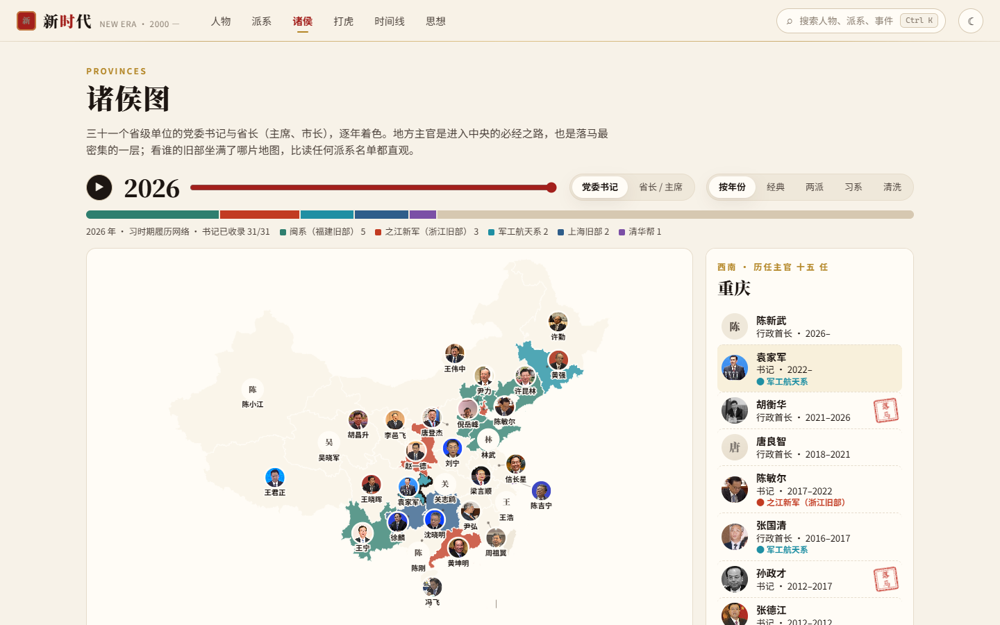
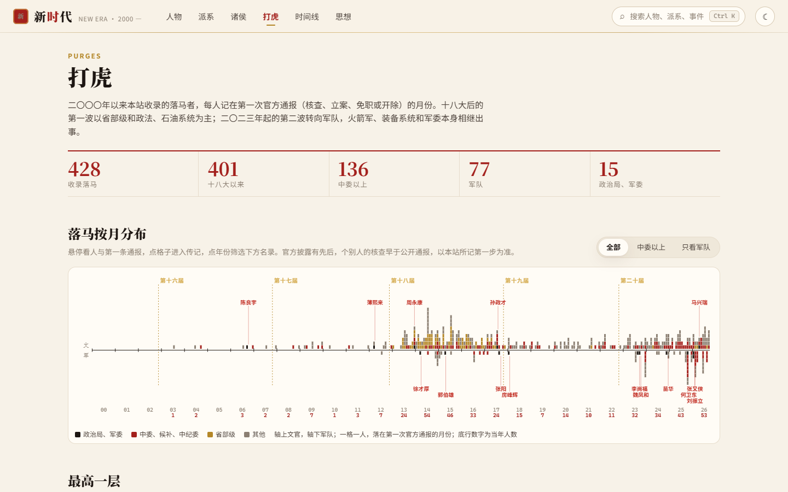
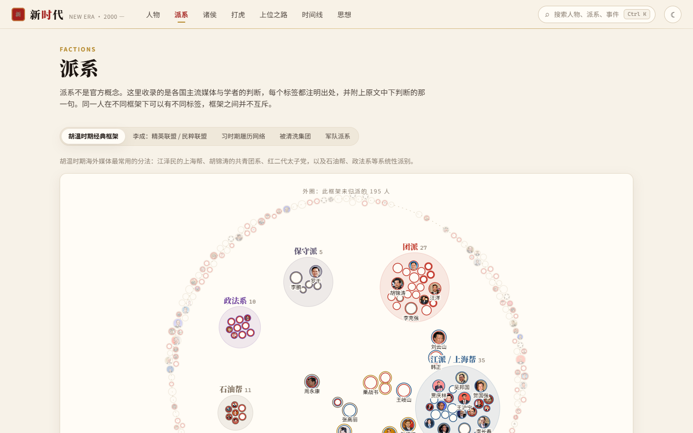
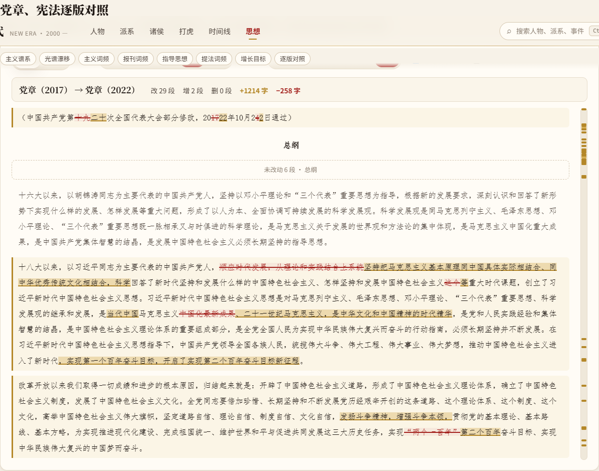

# 新时代 · New Era

2000 年以来的中国大陆政治专题，重心在习近平时期。

网站：<https://andyuneducated.github.io/new-era/>


## 栏目

- **人物**：十六至二十届全部中央委员与候补委员、落马官员、异见者、企业家、港澳台人物，约二千二百人，其中完整传记一百二十六篇。履历（时段带与地铁图）、名言、彩色照片（约四分之三有照片）、五百多条人物关系。
- **上位之路**：近二百人的命运转折点：哪件事把他推上去、走的哪条路线、各级台阶的年龄，附反例。
- **派系**：五套框架并列（胡温时期经典分法、李成的精英/民粹两派、习时期履历网络、被清洗集团、军中派系）。每个标签都注明是哪家媒体或学者说的，并附原句；各家判断不一致的人单列对照。派系河流看历届中委的派系构成。
- **诸侯**：三十一个省级单位的书记与省长逐年着色，诸侯谱一屏看完二十多年的地方主官更替。
- **打虎**：九百多名落马者按第一次官方通报的月份排开，文官在上、军队在下；每人有结构化的案件记录（系统、级别、东窗事发、通报措辞、罪名、刑期、金额、牵连对象）；最高一层、二〇二三年以来的军中清洗、各届中委落马率；三十七篇重点案件专题。
- **时间线**：十一条泳道，1989–1999 前史加 2000 年至今，近八百条事件，含民间话语与传闻专题。
- **思想**：一百六十多个概念与论争；主义谱系与光谱漂移、《人民日报》提法词频、指导思想写入党章、政府工作报告增长目标、党章与宪法逐版对照阅读；思想落地图把提法、政策与事件连成线。

| 诸侯图 | 打虎 |
|---|---|
|  |  |
| **派系** | **党章逐版对照** |
|  |  |

## 体例

- 每句加引号的话在构建时与入库原文逐字比对，对不上不能发布。
- 官方文件全文入库；媒体与学者文章只存相关段落并记录网页哈希。
- 传闻（大纪元、看中国、新唐人、博讯、自媒体等）可以收，但一律带“传闻”记号，不能改变人物状态，派系标签与事件里与主流来源并列。
- 有争议的说法并列不同声部，不取其一；派系标签只表达“谁这样说”。
- 照片优先用维基共享资源的自由授权图片，其次为官方标准像，均注明出处。

详见 [`research/methods.md`](research/methods.md) 与 [`research/decisions.md`](research/decisions.md)，进度见 [`research/progress.md`](research/progress.md)。

## 开发

```sh
npm install
npm run dev          # 构建数据并启动 Vite
npm run data:build   # 只构建并校验数据（报告见 .probe/build-report.txt）
npm run data:fetch -- --report=X id1 id2   # 抓取登记过的来源
npm run data:photos  # 下载照片（Commons 优先）
npm test             # 单元测试
npm run build && npm run test:smoke        # 冒烟测试
node tools/shot.ts --out=docs/screens home # 截图（需先在 4189 端口起服务）
```

内容在 `content/`（YAML），来源登记在 `research/manifests/`，入库原文在 `sources/text/`。写内容前先读 [`research/howto-content.md`](research/howto-content.md)。

MIT License.
